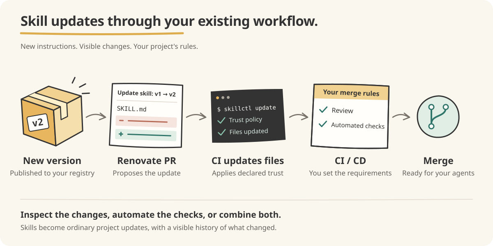

# skillctl-consumer-example

Example consumer repository demonstrating how [skillctl](https://github.com/vrothberg/skillctl) tracks OCI-based AI agent skills and integrates with Renovate for automated version updates.

## How it works



`skillctl.yaml` pins each skill to an OCI tag and digest. Renovate proposes
updates, and CI applies the declared trust policy and updates the extracted
files. Inspect the changes, run automated checks, or combine both: your
project decides when updates merge.

## Setup

```console
$ skillctl init
$ skillctl pull --trust none quay.io/vrothberg/skillctl-example-skill:v1.0.0
```

The example skill is published unsigned, so its manifest entry declares `trust: none`, an explicit opt-out of signature verification. Skills with a `trust: {key: ...}` entry are verified against that public key on every pull and update; see the [skillctl README](https://github.com/vrothberg/skillctl#trust-and-signature-verification).

This repo also consumes a signed variant, `skillctl-example-signed-skill`. Its manifest entry pins the publisher's public key (`keys/skillctl-example-signed-skill.pub`), so every pull and update verifies the artifact's sigstore signature against that key before extracting it:

```yaml
- name: skillctl-example-signed-skill
  image: quay.io/vrothberg/skillctl-example-signed-skill:v1.0.0
  digest: sha256:...
  extractPath: .agents/skills/skillctl-example-signed-skill
  trust:
      key: keys/skillctl-example-signed-skill.pub
```

To pull it into a new repo:

```console
$ skillctl pull --trust key=keys/skillctl-example-signed-skill.pub quay.io/vrothberg/skillctl-example-signed-skill:v1.0.0
```

## Simulating an update

In the [skillctl](https://github.com/vrothberg/skillctl) repo:

```console
# Bump the counter
echo 2 > hack/example-skill/counter.txt

# Build and push a new version
./hack/build-example-skill.sh v1.0.1
```

Renovate will detect the new tag and open a PR in this repo to update `skillctl.yaml`.
